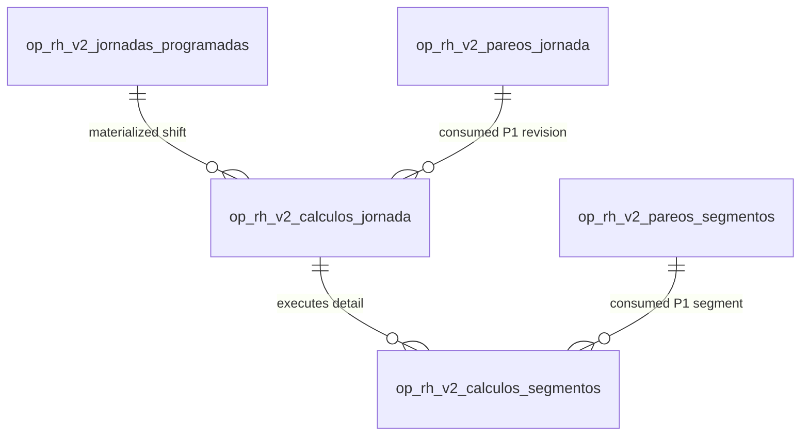

# CHECADOR V2 — P2 JOURNEY CALCULATION PHYSICAL PERSISTENCE MODEL

## 1. CONTROL HEADER

- **Document Name:** CHECADOR V2 — P2 JOURNEY CALCULATION PHYSICAL PERSISTENCE MODEL
- **Document Version:** 1.0 (FROZEN_V1.0)
- **Status:** FROZEN_V1.0
- **Effective Scope:** Technical Motor de Jornada V2 — Phase 2 (Calculation Results Physical Storage)
- **Target Execution Date:** 2026-12-31
- **Authoritative Architecture:** `docs/architecture/CHECADOR_V2_ARCHITECTURE_FREEZE_V1.0.md`
- **Shift Model Physical Spec:** `docs/architecture/CHECADOR_V2_SHIFT_SCHEDULING_PHYSICAL_MODEL_V1.0.md`
- **Authoritative Pairing Spec:** `docs/architecture/CHECADOR_V2_JOURNEY_PAIRING_PHYSICAL_MODEL_V1.0.md`
- **Authoritative Calculation Contract:** `docs/v2/CHECADOR_V2_JOURNEY_CALCULATION_CONTRACT_V1.0.md`

---

## 2. PURPOSE & PHYSICAL BOUNDARIES

### 2.1 Primary Objective
This specification defines the canonical, append-only physical database schema for persisting Phase 2 (P2) Journey Calculation execution results.
It provides a normalized, audit-reproducible, and referentially intact structure for storing derived technical attendance metrics, duration totals, and signed arrival/departure deltas calculated from immutable scheduled shifts (`op_rh_v2_jornadas_programadas`) and immutable P1 pairing revisions (`op_rh_v2_pareos_jornada`).

### 2.2 Scope Exclusions & Hard Invariants (NON-GOALS)
This physical schema explicitly **MUST NOT**:
- Store administrative `FALTA` (absence) states or columns.
- Store administrative `RETARDO` or `SALIDA_ANTICIPADA` classification columns.
- Store administrative `SIN MARCACIÓN` conclusions beyond technical calculation statuses.
- Store administrative incidence flags (`justificado`, `autorizado`, `incidencia_id`).
- Store payroll figures, overtime approvals (`payable_overtime`), multipliers, or monetary amounts.
- Mutate, update, or delete raw facts in `op_rh_v2_marcaciones_crudas`.
- Modify `op_rh_v2_jornadas_programadas`, P1 pairing tables, or legacy `op_rh_personal_asistencia`.

### 2.3 Official Business Terminology
In alignment with project rules, all future evaluation or reporting of P2 outputs against legacy results is designated as:
> **“comparación paralela sin afectar nómina”**

---

## 3. PHYSICAL SOURCE ENTITY MAPPING & TYPE COMPATIBILITY

| Conceptual Entity | Physical Database Table | Primary Key | Key Referenced Columns | FK Action / Integrity |
| :--- | :--- | :--- | :--- | :--- |
| **ScheduledShift** | `op_rh_v2_jornadas_programadas` | `id BIGINT UNSIGNED` | `id_personal INT`, `id_estacion INT`, `fecha_jornada_local DATE` | `ON DELETE RESTRICT` |
| **P1 Pairing Header** | `op_rh_v2_pareos_jornada` | `id BIGINT UNSIGNED` | `id_jornada_programada BIGINT UNSIGNED`, `revision_numero INT UNSIGNED` | `ON DELETE RESTRICT` |
| **P1 Segment Result** | `op_rh_v2_pareos_segmentos` | `id BIGINT UNSIGNED` | `id_pareo_jornada BIGINT UNSIGNED`, `ordinal_segmento TINYINT UNSIGNED` | `ON DELETE RESTRICT` |

- **FK Type Compatibility:** `PASS`. `id_jornada_programada` and `id_pareo_jornada` match `BIGINT UNSIGNED NOT NULL`.

---

## 4. SCHEMA DECOMPOSITION & DOMAIN MODEL

To ensure complete multi-segment explainability, atomic calculation revisions, and audit integrity without relying on opaque JSON arrays or minute-rounded lossy figures, P2 physical storage is decomposed into two normalized physical tables:



1. **`op_rh_v2_calculos_jornada` (Calculation Header & Revision Provenance):**
   Stores top-level journey calculation revision, algorithm version, overall calculation status, SHA256 input fingerprint, journey aggregate metrics (`segundos_trabajados_totales`, `segundos_programados_totales`, `segundos_candidatos_fuera_horario`), and explicit P1 pairing revision provenance.
2. **`op_rh_v2_calculos_segmentos` (Per-Segment Calculation Result Detail):**
   Stores per-segment derived metrics (`segundos_trabajados`, `segundos_programados`, `delta_llegada_segundos`, `delta_salida_segundos`, `segundos_candidatos_fuera_horario`) and explicit references to corresponding P1 segment pairing records (`id_pareo_segmento`).

---

## 5. HISTORICAL REVISION & APPEND-ONLY MODEL

### 5.1 Immutable Revision Sequence
- Calculation execution records are strictly **append-only**. In-place `UPDATE` or `DELETE` operations on `op_rh_v2_calculos_jornada` or `op_rh_v2_calculos_segmentos` are prohibited.
- Hard immutability on header rows is enforced via database triggers (`tg_op_rh_v2_calculos_jornada_no_update` and `tg_op_rh_v2_calculos_jornada_no_delete`).
- When a new P1 pairing revision is generated (e.g., due to late punch arrival or Level 2 sync completion), a new P2 calculation revision is inserted with `revision_numero = revision_numero + 1`.
- Previous calculation revisions remain 100% intact and queryable for historical audit.

### 5.2 Latest Revision Resolution
Querying active/latest calculation output uses pure relational ordering:
```sql
SELECT * FROM op_rh_v2_calculos_jornada
WHERE id_jornada_programada = :id_jornada
ORDER BY revision_numero DESC
LIMIT 1;
```

---

## 6. PROPOSED MARIADB PHYSICAL DDL (NON-APPLIED)

```sql
-- =============================================================================
-- MIGRACIÓN ADITIVA V2: CHECADOR V2 JOURNEY CALCULATION PHYSICAL PERSISTENCE (SLICE V2.4-P2S)
-- Spec Version: 1.0 (FROZEN_V1.0)
-- =============================================================================

-- 1. Tabla Header de Cálculo de Jornada (Calculation Revision Header)
CREATE TABLE IF NOT EXISTS `op_rh_v2_calculos_jornada` (
  `id` BIGINT UNSIGNED NOT NULL AUTO_INCREMENT,
  `id_jornada_programada` BIGINT UNSIGNED NOT NULL COMMENT 'FK to op_rh_v2_jornadas_programadas',
  `id_pareo_jornada` BIGINT UNSIGNED NOT NULL COMMENT 'FK to explicit immutable op_rh_v2_pareos_jornada revision',
  `id_personal` INT NOT NULL COMMENT 'Worker ID snapshot',
  `id_estacion` INT NOT NULL COMMENT 'Workplace station ID snapshot',
  `fecha_jornada_local` DATE NOT NULL COMMENT 'Local work date snapshot (YYYY-MM-DD)',
  `revision_numero` INT UNSIGNED NOT NULL DEFAULT 1 COMMENT 'Monotonic revision number per scheduled shift',
  `version_algoritmo_calculo` VARCHAR(32) NOT NULL DEFAULT 'v2.4-p2' COMMENT 'Calculation algorithm version provenance',
  `estado_calculo` VARCHAR(32) NOT NULL COMMENT 'Calculation status (CALCULATED, PARTIAL_DATA, PENDING_SYNC, AMBIGUOUS, WORKPLACE_MISMATCH, UNMATCHED_NO_PUNCHES, INVALID_INTERVAL, DAY_OFF_RECORDED, UNSCHEDULED_RECORDED, UNKNOWN_SCHEDULE)',
  `segundos_programados_totales` INT UNSIGNED NULL COMMENT 'Total scheduled work seconds across all WORK segments (NULL for UNSCHEDULED/UNKNOWN)',
  `segundos_trabajados_totales` INT UNSIGNED NULL COMMENT 'Total actual worked seconds across complete WORK segments (NULL if incomplete/partial)',
  `segundos_candidatos_fuera_horario` INT UNSIGNED NULL COMMENT 'Net technical work seconds outside scheduled boundaries (Candidate, NOT approved overtime)',
  `fingerprint_ejecucion` VARCHAR(64) NOT NULL COMMENT 'SHA256 fingerprint of input schedule + P1 pairing parameters + algorithm version',
  `creado_at_utc` DATETIME NOT NULL DEFAULT CURRENT_TIMESTAMP,
  PRIMARY KEY (`id`),
  UNIQUE KEY `uk_v2_calculo_jornada_revision` (`id_jornada_programada`, `revision_numero`),
  UNIQUE KEY `uk_v2_calculo_fingerprint` (`fingerprint_ejecucion`),
  KEY `idx_v2_calculo_pareo_jornada` (`id_pareo_jornada`),
  KEY `idx_v2_calculo_personal_fecha` (`id_personal`, `fecha_jornada_local`, `revision_numero`),
  KEY `idx_v2_calculo_estado` (`estado_calculo`),
  CONSTRAINT `fk_v2_calculo_jornada_programada` FOREIGN KEY (`id_jornada_programada`) REFERENCES `op_rh_v2_jornadas_programadas` (`id`) ON DELETE RESTRICT,
  CONSTRAINT `fk_v2_calculo_pareo_jornada` FOREIGN KEY (`id_pareo_jornada`) REFERENCES `op_rh_v2_pareos_jornada` (`id`) ON DELETE RESTRICT
) ENGINE=InnoDB DEFAULT CHARSET=utf8mb4 COLLATE=utf8mb4_unicode_ci;

-- 2. Tabla de Detalles por Segmento Calculado (Per-Segment Calculation Result Detail)
CREATE TABLE IF NOT EXISTS `op_rh_v2_calculos_segmentos` (
  `id` BIGINT UNSIGNED NOT NULL AUTO_INCREMENT,
  `id_calculo_jornada` BIGINT UNSIGNED NOT NULL COMMENT 'FK to op_rh_v2_calculos_jornada header',
  `id_pareo_segmento` BIGINT UNSIGNED NULL COMMENT 'FK to op_rh_v2_pareos_segmentos (NULL for UNSCHEDULED)',
  `ordinal_segmento` TINYINT UNSIGNED NOT NULL COMMENT 'Segment position ordinal (1, 2, 3...)',
  `tipo_segmento` VARCHAR(16) NOT NULL DEFAULT 'WORK' COMMENT 'Segment type (WORK, BREAK)',
  `estado_segmento` VARCHAR(32) NOT NULL COMMENT 'Segment calculation state (CALCULATED, PARTIAL_DATA, UNMATCHED_NO_PUNCHES, INVALID_INTERVAL)',
  `segundos_programados` INT UNSIGNED NULL COMMENT 'Scheduled work seconds for this segment',
  `segundos_trabajados` INT UNSIGNED NULL COMMENT 'Actual worked seconds for this segment (NULL if partial/invalid)',
  `delta_llegada_segundos` INT NULL COMMENT 'Signed entry delta in seconds (+late, -early, NULL if no entry punch)',
  `delta_salida_segundos` INT NULL COMMENT 'Signed exit delta in seconds (+late, -early, NULL if no exit punch)',
  `segundos_candidatos_fuera_horario` INT UNSIGNED NULL COMMENT 'Technical outside-schedule seconds for this segment',
  `creado_at_utc` DATETIME NOT NULL DEFAULT CURRENT_TIMESTAMP,
  PRIMARY KEY (`id`),
  UNIQUE KEY `uk_v2_calculo_seg_ordinal` (`id_calculo_jornada`, `ordinal_segmento`),
  KEY `idx_v2_calc_seg_pareo` (`id_pareo_segmento`),
  CONSTRAINT `fk_v2_calc_seg_header` FOREIGN KEY (`id_calculo_jornada`) REFERENCES `op_rh_v2_calculos_jornada` (`id`) ON DELETE CASCADE,
  CONSTRAINT `fk_v2_calc_seg_pareo` FOREIGN KEY (`id_pareo_segmento`) REFERENCES `op_rh_v2_pareos_segmentos` (`id`) ON DELETE RESTRICT
) ENGINE=InnoDB DEFAULT CHARSET=utf8mb4 COLLATE=utf8mb4_unicode_ci;

-- 3. Triggers de Protección Append-Only sobre Headers de Cálculo
DELIMITER $$

DROP TRIGGER IF EXISTS `tg_op_rh_v2_calculos_jornada_no_update`$$
CREATE TRIGGER `tg_op_rh_v2_calculos_jornada_no_update`
BEFORE UPDATE ON `op_rh_v2_calculos_jornada`
FOR EACH ROW
BEGIN
    SIGNAL SQLSTATE '45000'
    SET MESSAGE_TEXT = 'ERROR: Hard immutability enforced. UPDATE operations are strictly prohibited on op_rh_v2_calculos_jornada.';
END$$

DROP TRIGGER IF EXISTS `tg_op_rh_v2_calculos_jornada_no_delete`$$
CREATE TRIGGER `tg_op_rh_v2_calculos_jornada_no_delete`
BEFORE DELETE ON `op_rh_v2_calculos_jornada`
FOR EACH ROW
BEGIN
    SIGNAL SQLSTATE '45000'
    SET MESSAGE_TEXT = 'ERROR: Hard immutability enforced. DELETE operations are strictly prohibited on op_rh_v2_calculos_jornada.';
END$$

DELIMITER ;
```

---

## 7. FUTURE SCHEMA TEST MATRIX

| Test ID | Test Scenario | Acceptance Criteria |
| :--- | :--- | :--- |
| `S01` | Clean DDL execution | Both tables created cleanly with exact column types and constraints |
| `S02` | Foreign Key Compatibility | `id_jornada_programada` and `id_pareo_jornada` enforce `ON DELETE RESTRICT` against source tables |
| `S03` | Revision 1 insertion | Valid insert into header and detail child table |
| `S04` | Revision 2 insertion | Monotonic revision 2 accepted for same `id_jornada_programada` |
| `S05` | Duplicate revision rejection | Re-inserting existing `(id_jornada_programada, revision_numero)` rejected by UK |
| `S06` | Duplicate fingerprint rejection | Idempotency enforced by `uk_v2_calculo_fingerprint` |
| `S07` | Signed deltas support | `delta_llegada_segundos` accepts positive (+600) and negative (-300) values |
| `S08` | NULL duration semantics | `segundos_trabajados_totales = NULL` accepted for `PARTIAL_DATA` / `INVALID_INTERVAL` |
| `S09` | Multi-segment detail links | 1 header cleanly links to 2 child segment calculation rows |
| `S10` | Append-only trigger UPDATE rejection | `UPDATE op_rh_v2_calculos_jornada` fails with SQLSTATE 45000 |
| `S11` | Append-only trigger DELETE rejection | `DELETE FROM op_rh_v2_calculos_jornada` fails with SQLSTATE 45000 |
| `S12` | Schema Rollback | DOWN migration cleanly drops triggers and tables without FK errors |

---

## 8. PHYSICAL SUFFICIENCY GATE & FREEZE STATUS

- **`P2_PHYSICAL_SCHEMA_READY`:** **YES**
- **`ONE_TABLE_MODEL_SUFFICIENT`:** **NO** (Normalized 2-table model required for multi-segment explainability)
- **`PHYSICAL_MODEL_STATUS`:** **`FROZEN_V1.0`**
