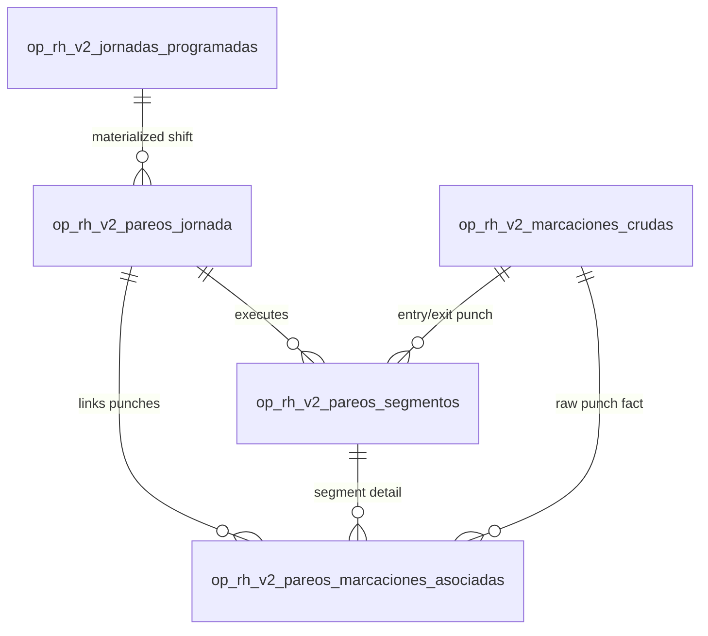

# CHECADOR V2 — PUNCHEVENT / SCHEDULEDSHIFT PAIRING PHYSICAL MODEL

## 1. CONTROL HEADER

- **Document Name:** CHECADOR V2 — PUNCHEVENT / SCHEDULEDSHIFT PAIRING PHYSICAL MODEL
- **Document Version:** 1.0 (FROZEN_V1.0)
- **Status:** FROZEN_V1.0
- **Effective Scope:** Technical Motor de Jornada V2 — Phase 1 (Determinism & Pairing Storage)
- **Target Execution Date:** 2026-12-31
- **Authoritative Architecture:** `docs/architecture/CHECADOR_V2_ARCHITECTURE_FREEZE_V1.0.md`
- **Shift Model Physical Spec:** `docs/architecture/CHECADOR_V2_SHIFT_SCHEDULING_PHYSICAL_MODEL_V1.0.md`
- **Service API Contract Reference:** `docs/v2/CHECADOR_V2_SHIFT_SCHEDULING_SERVICE_API_CONTRACT_V1.0.md`
- **Authoritative Pairing Contract:** `docs/v2/CHECADOR_V2_JOURNEY_PAIRING_CONTRACT_V1.0.md`

---

## 2. PURPOSE & SCOPE BOUNDARIES

### 2.1 Primary Objective
This specification defines the canonical, append-only physical database schema for persisting Phase 1 (P1) PunchEvent / ScheduledShift pairing execution results.

It provides a normalized, audit-reproducible, and fully referentially intact structure for storing deterministic pairings between raw biometric punch events (`op_rh_v2_marcaciones_crudas`) and materialized daily scheduled shifts (`op_rh_v2_jornadas_programadas`).

### 2.2 Scope Exclusions (Non-goals)
This physical schema explicitly **MUST NOT**:
- Store worked minutes, lateness minutes, overtime, or payroll figures.
- Store administrative attendance incidences (e.g., `FALTA`, `JUSTIFICANTE`, `PERMISO`).
- Store administrative `SIN MARCACIÓN` conclusions beyond structural pairing statuses.
- Mutate, delete, or update raw facts in `op_rh_v2_marcaciones_crudas`.
- Modify `op_rh_v2_jornadas_programadas` or legacy `op_rh_personal_asistencia`.

---

## 3. PHYSICAL SOURCE ENTITY MAPPING

| Conceptual Entity | Physical Database Table | Primary Key | Key Referenced Columns | FK Action / Integrity |
| :--- | :--- | :--- | :--- | :--- |
| **Raw PunchEvent** | `op_rh_v2_marcaciones_crudas` | `id INT` | `ocurrido_at_utc DATETIME`, `id_personal_resuelto INT`, `id_estacion_resuelta INT` | `ON DELETE RESTRICT` (Protected by DB triggers) |
| **ScheduledShift** | `op_rh_v2_jornadas_programadas` | `id BIGINT UNSIGNED` | `id_personal INT`, `id_estacion INT`, `fecha_jornada_local DATE` | `ON DELETE RESTRICT` |
| **Shift Segment** | `op_rh_v2_turnos_segmentos` | `id INT UNSIGNED` | `ordinal TINYINT UNSIGNED`, `hora_inicio_local TIME` | Immutable segment snapshot reference |
| **Worker Identity** | `op_rh_v2_dispositivo_identidad_personal` | `id INT` | `id_personal INT`, `referencia_externa_personal VARCHAR(64)` | Stable worker integer ID reference |

### 3.1 Authoritative Punch Time
The authoritative physical timestamp for all candidate window evaluation and pairing sorting is:
$$\text{\texttt{op\_rh\_v2\_marcaciones\_crudas.ocurrido\_at\_utc}}$$

---

## 4. SCHEMA DECOMPOSITION & DOMAIN MODEL

To ensure maximum auditability, single-consumption enforcement, arbitrary surplus punch support, and referential integrity without relying on opaque JSON arrays, P1 pairing persistence is decomposed into three normalized physical tables:



1. **`op_rh_v2_pareos_jornada` (Pairing Header & Revision Provenance):**
   Stores the top-level pairing execution revision, algorithm version, Level 2 completeness state, and overall shift pairing status.
2. **`op_rh_v2_pareos_segmentos` (Segment Pairing Result):**
   Stores segment-level pairing outcomes (`EXACT_PAIR`, `PARTIAL_MISSING_IN`, etc.) and primary Entry/Exit punch event references for each segment.
3. **`op_rh_v2_pareos_marcaciones_asociadas` (Punch Link & Surplus Detail):**
   Stores normalized associations for all punches involved in the pairing execution (`ENTRY`, `EXIT`, `SURPLUS`, `UNMATCHED`, `AMBIGUOUS`), enforcing single punch consumption per execution revision via a strict database unique constraint.

---

## 5. HISTORICAL REVISION & APPEND-ONLY MODEL

### 5.1 Immutable Revision Sequence
- Pairing execution records are strictly **append-only**. In-place `UPDATE` or `DELETE` operations on historical pairing rows are prohibited.
- When new raw punches arrive or Level 2 sync status completes, a new revision row is inserted with `revision_numero = revision_numero + 1`.
- Old pairing revisions remain 100% queryable for audit trail and historical reproducibility.

### 5.2 Latest Revision Resolution
Readers identify the active/latest pairing revision using pure relational ordering without mutating historical rows:
```sql
SELECT * FROM op_rh_v2_pareos_jornada
WHERE id_jornada_programada = :id_jornada
ORDER BY revision_numero DESC
LIMIT 1;
```

---

## 6. PROPOSED MARIADB PHYSICAL DDL (NON-APPLIED)

```sql
-- =============================================================================
-- MIGRACIÓN ADITIVA V2: CHECADOR V2 PAIRING PHYSICAL STORAGE (SLICE V2.4-P1)
-- Spec Version: 1.0 (FROZEN_V1.0)
-- =============================================================================

-- 1. Tabla Header de Pareo de Jornada (Pairing Revision Header)
CREATE TABLE IF NOT EXISTS `op_rh_v2_pareos_jornada` (
  `id` BIGINT UNSIGNED NOT NULL AUTO_INCREMENT,
  `id_jornada_programada` BIGINT UNSIGNED NOT NULL COMMENT 'FK to op_rh_v2_jornadas_programadas',
  `id_personal` INT NOT NULL COMMENT 'Worker ID snapshot',
  `id_estacion` INT NOT NULL COMMENT 'Workplace station ID snapshot',
  `fecha_jornada_local` DATE NOT NULL COMMENT 'Local work date snapshot (YYYY-MM-DD)',
  `revision_numero` INT UNSIGNED NOT NULL DEFAULT 1 COMMENT 'Monotonic revision number per scheduled shift',
  `version_algoritmo` VARCHAR(32) NOT NULL DEFAULT 'v2.4-p1' COMMENT 'Algorithm version provenance',
  `estado_completitud_l2` VARCHAR(32) NOT NULL DEFAULT 'VERIFIED' COMMENT 'Level 2 completeness state (VERIFIED, PENDING_SYNC_COMPLETION, INCOMPLETE)',
  `estado_pareo` VARCHAR(32) NOT NULL COMMENT 'Overall status (EXACT_PAIR, PARTIAL_MISSING_IN, PARTIAL_MISSING_OUT, UNMATCHED_NO_PUNCHES, AMBIGUOUS_PAIRING, WORKPLACE_MISMATCH, PENDING_SYNC_COMPLETION)',
  `fingerprint_ejecucion` VARCHAR(64) NULL COMMENT 'SHA256 fingerprint of input events & schedule parameters',
  `supercedido_por_id` BIGINT UNSIGNED NULL COMMENT 'Optional pointer to superseding revision ID',
  `creado_at_utc` DATETIME NOT NULL DEFAULT CURRENT_TIMESTAMP,
  PRIMARY KEY (`id`),
  UNIQUE KEY `uk_v2_pareo_jornada_revision` (`id_jornada_programada`, `revision_numero`),
  KEY `idx_v2_pareo_personal_fecha` (`id_personal`, `fecha_jornada_local`, `revision_numero`),
  KEY `idx_v2_pareo_estacion_completitud` (`id_estacion`, `estado_completitud_l2`),
  CONSTRAINT `fk_v2_pareo_jornada_programada` FOREIGN KEY (`id_jornada_programada`) REFERENCES `op_rh_v2_jornadas_programadas` (`id`) ON DELETE RESTRICT
) ENGINE=InnoDB DEFAULT CHARSET=utf8mb4 COLLATE=utf8mb4_unicode_ci;

-- 2. Tabla de Resultados por Segmento (Pairing Segment Result)
CREATE TABLE IF NOT EXISTS `op_rh_v2_pareos_segmentos` (
  `id` BIGINT UNSIGNED NOT NULL AUTO_INCREMENT,
  `id_pareo_jornada` BIGINT UNSIGNED NOT NULL COMMENT 'FK to op_rh_v2_pareos_jornada header',
  `ordinal_segmento` TINYINT UNSIGNED NOT NULL COMMENT 'Segment position ordinal (1, 2, 3...)',
  `id_marcacion_entrada` INT NULL COMMENT 'FK to op_rh_v2_marcaciones_crudas for primary IN punch',
  `id_marcacion_salida` INT NULL COMMENT 'FK to op_rh_v2_marcaciones_crudas for primary OUT punch',
  `estado_segmento` VARCHAR(32) NOT NULL COMMENT 'Segment pairing status (EXACT_PAIR, PARTIAL_MISSING_IN, PARTIAL_MISSING_OUT, UNMATCHED_NO_PUNCHES, AMBIGUOUS_PAIRING, WORKPLACE_MISMATCH)',
  `creado_at_utc` DATETIME NOT NULL DEFAULT CURRENT_TIMESTAMP,
  PRIMARY KEY (`id`),
  UNIQUE KEY `uk_v2_pareo_segmento_ordinal` (`id_pareo_jornada`, `ordinal_segmento`),
  KEY `idx_v2_pareo_seg_entrada` (`id_marcacion_entrada`),
  KEY `idx_v2_pareo_seg_salida` (`id_marcacion_salida`),
  CONSTRAINT `fk_v2_pareo_seg_header` FOREIGN KEY (`id_pareo_jornada`) REFERENCES `op_rh_v2_pareos_jornada` (`id`) ON DELETE CASCADE,
  CONSTRAINT `fk_v2_pareo_seg_entrada` FOREIGN KEY (`id_marcacion_entrada`) REFERENCES `op_rh_v2_marcaciones_crudas` (`id`) ON DELETE RESTRICT,
  CONSTRAINT `fk_v2_pareo_seg_salida` FOREIGN KEY (`id_marcacion_salida`) REFERENCES `op_rh_v2_marcaciones_crudas` (`id`) ON DELETE RESTRICT
) ENGINE=InnoDB DEFAULT CHARSET=utf8mb4 COLLATE=utf8mb4_unicode_ci;

-- 3. Tabla de Marcaciones Asociadas y Excedentes (Punch Link & Surplus Detail)
CREATE TABLE IF NOT EXISTS `op_rh_v2_pareos_marcaciones_asociadas` (
  `id` BIGINT UNSIGNED NOT NULL AUTO_INCREMENT,
  `id_pareo_jornada` BIGINT UNSIGNED NOT NULL COMMENT 'FK to op_rh_v2_pareos_jornada header',
  `id_pareo_segmento` BIGINT UNSIGNED NULL COMMENT 'FK to op_rh_v2_pareos_segmentos (NULL if unassigned/day-off)',
  `id_marcacion_cruda` INT NOT NULL COMMENT 'FK to op_rh_v2_marcaciones_crudas',
  `rol_marcacion` VARCHAR(32) NOT NULL COMMENT 'Punch role (ENTRY, EXIT, SURPLUS, UNMATCHED, AMBIGUOUS)',
  `creado_at_utc` DATETIME NOT NULL DEFAULT CURRENT_TIMESTAMP,
  PRIMARY KEY (`id`),
  UNIQUE KEY `uk_v2_pareo_revision_marcacion` (`id_pareo_jornada`, `id_marcacion_cruda`),
  KEY `idx_v2_pareo_marc_cruda` (`id_marcacion_cruda`),
  KEY `idx_v2_pareo_marc_segmento` (`id_pareo_segmento`),
  CONSTRAINT `fk_v2_pareo_marc_header` FOREIGN KEY (`id_pareo_jornada`) REFERENCES `op_rh_v2_pareos_jornada` (`id`) ON DELETE CASCADE,
  CONSTRAINT `fk_v2_pareo_marc_segmento` FOREIGN KEY (`id_pareo_segmento`) REFERENCES `op_rh_v2_pareos_segmentos` (`id`) ON DELETE CASCADE,
  CONSTRAINT `fk_v2_pareo_marc_cruda` FOREIGN KEY (`id_marcacion_cruda`) REFERENCES `op_rh_v2_marcaciones_crudas` (`id`) ON DELETE RESTRICT
) ENGINE=InnoDB DEFAULT CHARSET=utf8mb4 COLLATE=utf8mb4_unicode_ci;
```

---

## 7. ENFORCEMENT & CONSTRAINTS MATRIX

### 7.1 Single Consumption Rule
- **Within Execution Revision:** Enforced at database level via `uk_v2_pareo_revision_marcacion` (`id_pareo_jornada`, `id_marcacion_cruda`). A single raw punch event cannot be assigned multiple roles within the same pairing execution.
- **Across Competing Shifts:** Enforced at service layer during pairing candidate window evaluation. If a single punch is claimed by two overlapping shift search windows without resolution, the engine flags `AMBIGUOUS_PAIRING` and prevents double-primary consumption.
- **Across Historical Revisions:** Allowed by design. Revision $N$ and Revision $N+1$ have distinct `id_pareo_jornada` PKs and can legitimately reference the same raw punch event.

### 7.2 Primary Entry / Exit Uniqueness
- Enforced at database level per segment result via `id_marcacion_entrada` and `id_marcacion_salida` column slots in `op_rh_v2_pareos_segmentos`.
- Maximum one Entry punch and maximum one Exit punch per segment revision. `NULL` values represent structural missing states (`PARTIAL_MISSING_IN`, `PARTIAL_MISSING_OUT`, `UNMATCHED_NO_PUNCHES`).

### 7.3 Arbitrary Surplus Punch Support
- Surplus punches are stored as normalized rows in `op_rh_v2_pareos_marcaciones_asociadas` with `rol_marcacion = 'SURPLUS'`.
- Supports 0..N surplus punches without arbitrary column limits or untyped JSON list columns.

---

## 8. FORMAL FREEZE DECLARATION

This physical data model is formally **FROZEN** as Version 1.0. Any future modifications require a formal revision proposal and explicit user authorization.

- **Freeze Date:** 2026-10-07
- **Status:** `FROZEN_V1.0`
